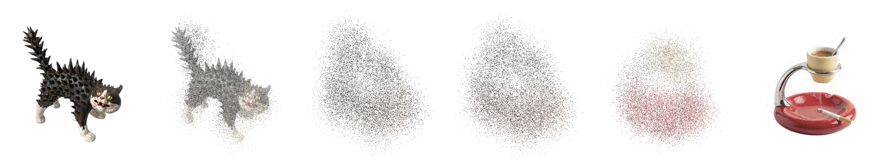

# Particles



A transition between two pictures made out of the pictures themselves. Tap the
object on screen and it comes apart into about fifteen thousand grains, each
one carrying the colour of the pixel it was lifted from; they fly, **repaint
themselves in mid-air**, and settle into the next object. Nothing fades into
anything — the same swarm is both pictures.

## Why

A cross-fade between two photographs says nothing about either of them. For
half a second you look at a double exposure, and the only thing it tells you is
that the app is loading something. The usual alternatives — a slide, a flip, a
scale — move the picture as one rectangle, so they say even less.

This moves the pixels. Every picture is sampled on one shared lattice, filed in
one shared order, and cut or padded to one shared population, so mote *n* of
the ashtray is mote *n* of the cat. A transition is then nothing but two
endpoints per mote, and what you watch is the first object's own material
rearranging itself into the second. The filing is what makes it read as a
turn rather than a reshuffle: motes are sorted into 512 wedges around the
centre and, inside a wedge, from the middle outwards, so a grain on the rim of
one picture lands near the rim of the next at roughly the same bearing.

The picture itself is a real `Image` underneath the whole time. The swarm is
not a replacement for it — it is a thin subsample that stands in for it for a
second, and the hard part is the moment they trade places.

## How

No dependencies. SwiftUI holds the screen, the gesture and the controls; the
swarm is GPU point sprites in an `MTKView` behind a `UIViewRepresentable`,
because fifteen thousand of them at 120 fps is not something to ask of SwiftUI.
Every trajectory — the path, the easing, the swirl, the colour, the size of
each grain — is a few lines of `MorphShaders.metal` evaluated per vertex per
frame. The Swift side hands over one struct of uniforms and gets out of the
way.

**Neither layer ever fades while the other one is fading.** This is the whole
trick of the handover, and the first version got it wrong: the picture faded
out over the same stretch that the motes faded in, two half-transparent copies
of the same thing stacked on each other, total coverage dipping to about three
quarters in the middle. On screen that is a blink. Now the motes come up to
full opacity *over* the picture that is still there, and only then does the
picture leave; at the far end the next picture comes up to full *under* a swarm
that is still solid, and only then does the swarm dissolve off it. Pinned to
progress, that is `[0, 0.07]` motes in, `[0.07, 0.16]` picture out,
`[0.72, 0.90]` picture in, `[0.90, 1.0]` motes out — and because a mote at rest
sits on its own pixel wearing its own colour, the two layers are the same thing
where they overlap, so the swap costs nothing.

**The flight is eased out of one picture and into the other**, which is not the
same as easing in and out of the transition. The first half is a cubic
ease-out, the second a cubic ease-in, and they meet at the waist, where the
swarm is at its loosest. Standard easing would do the reverse — creep away from
the picture and creep into the next one — and the burst is the part that wants
to be sudden. The two halves have **their own durations**: real time is mapped
onto the progress axis so that the waist always falls on 0.5, which lets the
break-apart be a flick and the gathering a long drift, or the other way round,
without touching anything else.

A swarm that has finished bursting but not started gathering would hang in the
air, so three things keep it alive: a thread of plain linear progress mixed
into the easing at 18 %, so it never quite stops; a slow turn of the whole
cloud, wound up on the way out and unwound on the way back; and a small circle
each mote swims on its own clock. All three are scaled by `sin(e·π)` — full at
the waist, exactly zero at both ends — so none of them smears either picture.

Two smaller ones. Each mote crosses on a **bowed path**, not a straight line:
the control point is pushed off the midpoint along a bearing that is only a
third radial and otherwise random, because a clean radial shove blows the swarm
into a ring with a hole punched through the middle. And a mote **keeps its old
colour well into the crossing** and repaints over a short stretch near the
waist, rather than spending the flight as a wash halfway between two pictures;
the brightest grains are also shaded while they are loose, or they vanish
against the white.

The press is its own small thing. The object goes to 90 % under a finger, and
both the picture and the canvas are scaled together so the swarm never jumps
when a press turns into a morph. It is one `DragGesture(minimumDistance: 0)`
rather than a tap plus a press: `onTapGesture` gives up if the finger is held,
which left a press that squeezed the object and then did nothing.

Everything with a number behind it is on a slider — the two durations, the
lattice, the population, grain size, spread, swirl, drift. The five that only
feed uniforms apply as the slider moves, so you can tap and keep dragging; the
two that re-cut the pictures fire on release, so dragging them stays smooth.

```
Particles/
  MorphScreen.swift      the screen: picture, press, the handover schedule
  MorphCanvas.swift      MTKView, the render loop, uniforms
  MorphShaders.metal     the flight: path, easing, swirl, colour, size
  MorphField.swift       pictures → one interchangeable swarm
  MorphSettings.swift    every knob, and the split timeline
  MorphControls.swift    the panel
```

## Run

Open `Particles.xcodeproj`, pick a simulator, Run. Tap the object to send it
through to the next one; the button in the bottom right opens the sliders. The
three demo pictures are in the asset catalogue — any cut-out with an alpha
channel will do, so swap them for your own and nothing else needs to change.

---

MIT — see [LICENSE](LICENSE).
